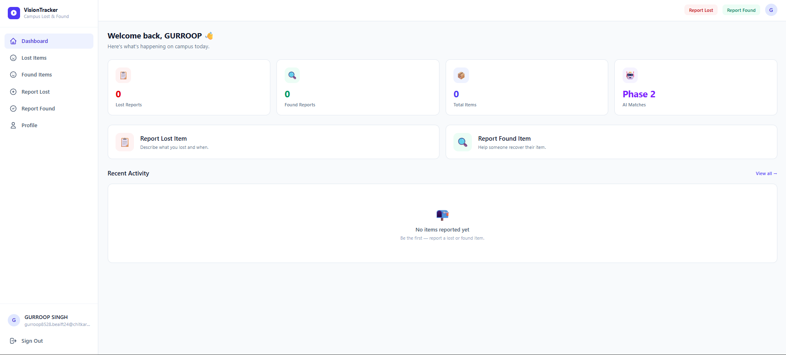
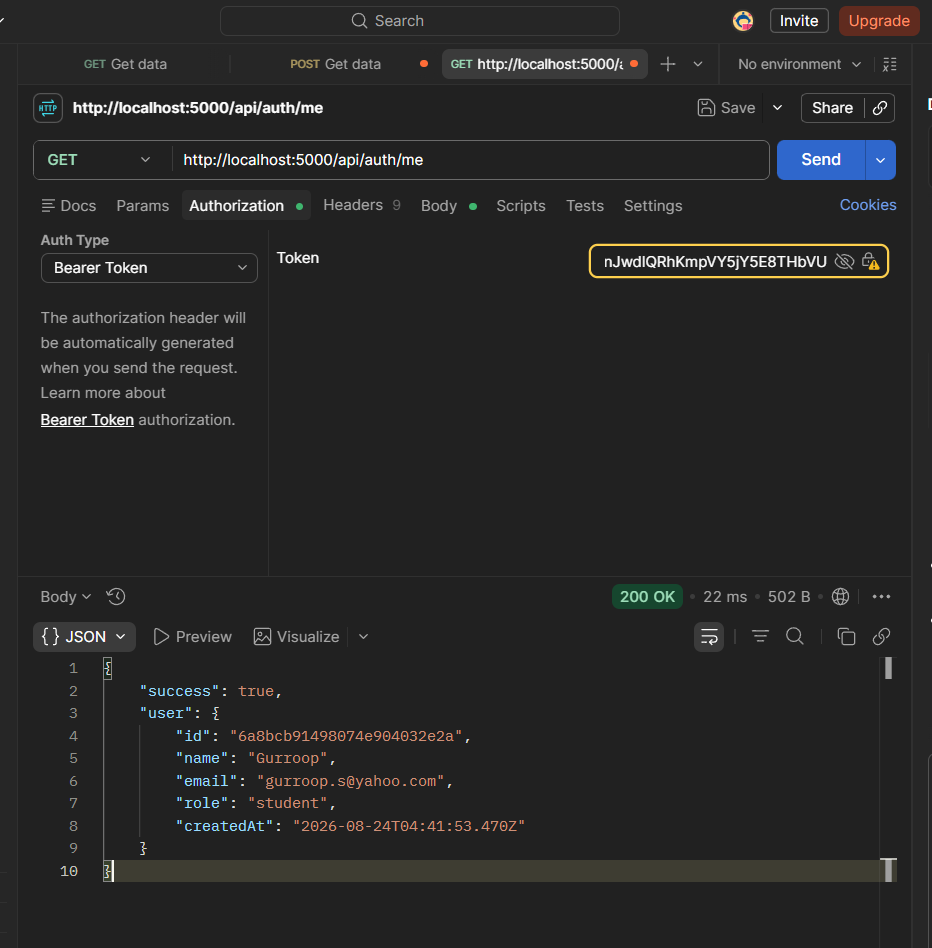
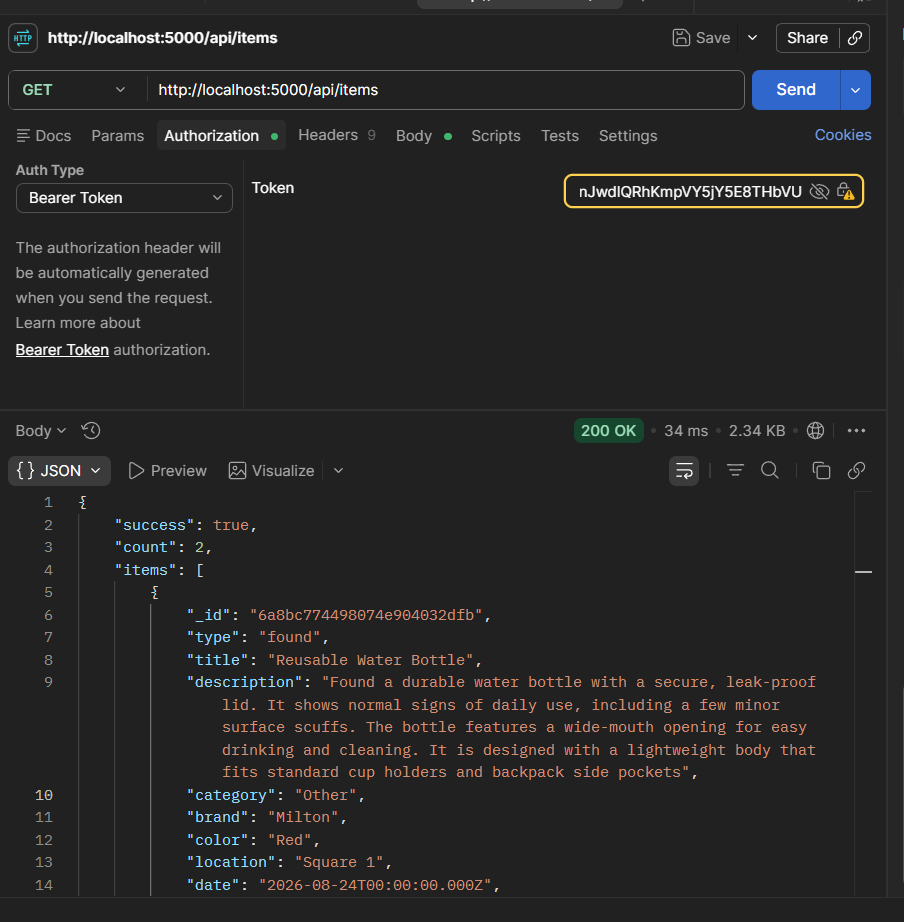

# VisionTracker — AI-Powered Campus Lost & Found

> **Course:** Back End Engineering (24CAI0303)  
> **University:** Chitkara University  
> **Phase:** 2 of 2 (Complete)

---

## Problem Statement

Students on campus lose belongings every day — laptops, ID cards, water bottles, keys. The current process is informal: WhatsApp groups, notices pinned on boards, word of mouth. There is no central system, no search, and no matching. VisionTracker solves this with a structured digital platform where students can report and browse lost and found items in real time.

---

## Project Overview

VisionTracker is a campus Lost & Found web application. In Phase 1 it provides:

- Student registration and login
- Dashboard with live item statistics
- Lost and found item feeds with search and category filters
- Item detail pages
- Report Lost Item and Report Found Item forms
- User profile with their own reports
- Secure JWT-based authentication

In Phase 2, AI image matching will automatically pair lost reports with found items.

---

## Features

| Feature | Phase 1 | Phase 2 |
|---------|---------|---------|
| User registration and login | ✅ | — |
| JWT authentication | ✅ | — |
| Report lost item | ✅ | — |
| Report found item | ✅ | — |
| Browse and search items | ✅ | — |
| Item detail page | ✅ | — |
| User profile | ✅ | — |
| Image upload (Multer) | — | ✅ |
| AI image matching | — | ✅ |
| Real-time notifications (Socket.IO) | — | ✅ |
| Redis caching | — | ✅ |
| Docker / Kubernetes | — | ✅ |

---

## Technology Stack

### Frontend
| Technology | Purpose |
|------------|---------|
| React 19 | UI library |
| Vite | Build tool and dev server |
| Tailwind CSS v4 | Utility-first styling |
| React Router v7 | Client-side routing |
| Axios | HTTP client |
| Context API | Global authentication state |

### Backend
| Technology | Purpose |
|------------|---------|
| Node.js | Runtime |
| Express.js | REST API framework |
| MongoDB | Database |
| Mongoose | ODM |
| bcryptjs | Password hashing |
| jsonwebtoken | JWT auth |
| dotenv | Environment variables |
| cors | Cross-origin support |

---

## Architecture

```
Browser (React + Vite)
  └─ Context API (auth state)
  └─ React Router (public + protected routes)
  └─ Axios services (api.js / authService.js / itemService.js)
       │
       ▼ HTTP REST
Node.js + Express (localhost:5000)
  └─ authRoutes → authController
  └─ itemRoutes → itemController
  └─ JWT middleware
  └─ Error middleware
       │
       ▼ Mongoose
MongoDB (Local / Automatic In-Memory Fallback)
  └─ users collection
  └─ items collection
```

See [`docs/ARCHITECTURE.md`](docs/ARCHITECTURE.md) for the full diagram.

---

## Project Structure

```
visiontracker/
├── backend/
│   ├── src/
│   │   ├── config/db.js
│   │   ├── controllers/
│   │   │   ├── authController.js
│   │   │   └── itemController.js
│   │   ├── middleware/
│   │   │   ├── authMiddleware.js
│   │   │   └── errorMiddleware.js
│   │   ├── models/
│   │   │   ├── User.js
│   │   │   └── Item.js
│   │   ├── routes/
│   │   │   ├── authRoutes.js
│   │   │   └── itemRoutes.js
│   │   ├── utils/generateToken.js
│   │   └── server.js
│   ├── .env.example
│   └── package.json
│
├── frontend/
│   ├── src/
│   │   ├── context/AuthContext.jsx
│   │   ├── components/
│   │   │   ├── ProtectedRoute.jsx
│   │   │   ├── ItemCard.jsx
│   │   │   ├── Spinner.jsx
│   │   │   └── Toast.jsx
│   │   ├── layouts/DashboardLayout.jsx
│   │   ├── pages/
│   │   │   ├── LandingPage.jsx
│   │   │   ├── LoginPage.jsx
│   │   │   ├── RegisterPage.jsx
│   │   │   ├── DashboardPage.jsx
│   │   │   ├── ItemsListPage.jsx
│   │   │   ├── ItemDetailPage.jsx
│   │   │   ├── ReportLostPage.jsx
│   │   │   ├── ReportFoundPage.jsx
│   │   │   ├── ProfilePage.jsx
│   │   │   └── NotFoundPage.jsx
│   │   ├── services/
│   │   │   ├── api.js
│   │   │   ├── authService.js
│   │   │   └── itemService.js
│   │   ├── App.jsx
│   │   ├── main.jsx
│   │   └── index.css
│   ├── index.html
│   ├── vite.config.js
│   └── package.json
│
├── docs/
│   ├── screenshots/
│   ├── API.md
│   ├── ARCHITECTURE.md
│   ├── AUDIT-REPORT.md
│   ├── CLO-MAPPING.md
│   └── PHASE-1.md
│
├── .gitignore
└── README.md
```

---

## Setup Instructions

### Prerequisites

- **Node.js** v18 or higher — [nodejs.org](https://nodejs.org)
- **npm** (included with Node.js)
- **MongoDB** *(Optional)* — The application will attempt to connect to a local MongoDB instance. If unavailable, it automatically falls back to an **in-memory database** for development/evaluation purposes (note: in-memory data is not persistent across server restarts).

---

### 1. Clone the repository

```bash
git clone <repository-url>
cd visiontracker
```

---

### 2. Backend setup

```bash
cd backend
```

Copy the environment file and fill in your values:

```bash
cp .env.example .env
```

Edit `.env`:

```env
PORT=5000
NODE_ENV=development
MONGODB_URI=mongodb://localhost:27017/visiontracker
JWT_SECRET=your_long_random_secret_here
JWT_EXPIRES_IN=7d
CLIENT_URL=http://localhost:5173
```

Install dependencies and start the dev server:

```bash
npm install
npm run dev
```

Backend will start at: `http://localhost:5000`  
Health check: `http://localhost:5000/api/health`

---

### 3. Frontend setup

Open a new terminal:

```bash
cd frontend
npm install
npm run dev
```

Frontend will start at: `http://localhost:5173`

---

## Environment Variables

### Backend (`backend/.env`)

| Variable | Description | Example |
|----------|-------------|---------|
| `PORT` | API server port | `5000` |
| `NODE_ENV` | Environment | `development` |
| `MONGODB_URI` | MongoDB connection string | `mongodb://localhost:27017/visiontracker` |
| `JWT_SECRET` | Secret for signing JWTs | Long random string |
| `JWT_EXPIRES_IN` | Token expiry | `7d` |
| `CLIENT_URL` | Frontend URL for CORS | `http://localhost:5173` |

**Never commit `.env` — it is in `.gitignore`.**

---

## API Overview

| Method | Endpoint | Auth | Description |
|--------|----------|------|-------------|
| GET | `/api/health` | None | Health check |
| POST | `/api/auth/register` | None | Register |
| POST | `/api/auth/login` | None | Login |
| GET | `/api/auth/me` | JWT | Get profile |
| GET | `/api/items` | None | List items |
| GET | `/api/items/:id` | None | Item detail |
| POST | `/api/items/lost` | JWT | Report lost |
| POST | `/api/items/found` | JWT | Report found |
| PUT | `/api/items/:id` | JWT | Update item |
| DELETE | `/api/items/:id` | JWT | Delete item |

See [`docs/API.md`](docs/API.md) for full request/response documentation.

---

## CLO Mapping

| Topic | File |
|-------|------|
| useState | `frontend/src/pages/LoginPage.jsx` (and 7 more) |
| useEffect | `frontend/src/context/AuthContext.jsx` (and 4 more) |
| Controlled Components | All form pages |
| Context API | `frontend/src/context/AuthContext.jsx` |
| React Router | `frontend/src/App.jsx` |
| Axios | `frontend/src/services/api.js` |
| Tailwind CSS | All frontend files |
| Express + REST | `backend/src/server.js`, routes/, controllers/ |
| MongoDB + Mongoose | `backend/src/config/db.js`, models/ |
| JWT Middleware | `backend/src/middleware/authMiddleware.js` |
| Error Middleware | `backend/src/middleware/errorMiddleware.js` |

See [`docs/CLO-MAPPING.md`](docs/CLO-MAPPING.md) for the full detailed mapping with code snippets.

---

## Phase 1 Scope

Phase 1 implements the frontend and backend CLO topics planned for the first evaluation and provides the foundation for the remaining advanced CLO requirements in Phase 2.

## Phase 2 Scope (Completed)

- ✅ Multer image upload for found items
- ✅ FastAPI Python microservice for AI image embedding (CLIP model)
- ✅ AI similarity matching between lost and found item images
- ✅ Socket.IO real-time notifications on match
- ✅ Redis caching for item feeds
- ✅ Docker Compose for local development
- ✅ Kubernetes manifests for deployment

---

## Screenshots

<div align="center">
  
  
  
  
  
  
</div>

---

## Team Contribution

| Member | Modules Owned |
|--------|--------------|
| **Ishpreet Singh** | Project initialization, Frontend Architecture, Tailwind UI, Landing/404 pages |
| **Gurroop Singh** | Authentication UI, Context API, React Router, Global State, MongoDB fallback |
| **Himanshu Bansal** | Express REST API, MongoDB Schemas, JWT Security, Lost & Found feature interfaces |

> Detailed contribution mapping to course lectures is available in [`docs/AUDIT-REPORT.md`](docs/AUDIT-REPORT.md).
